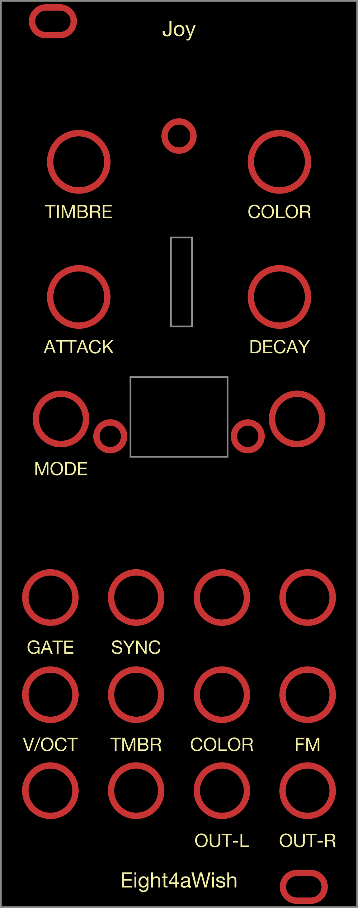
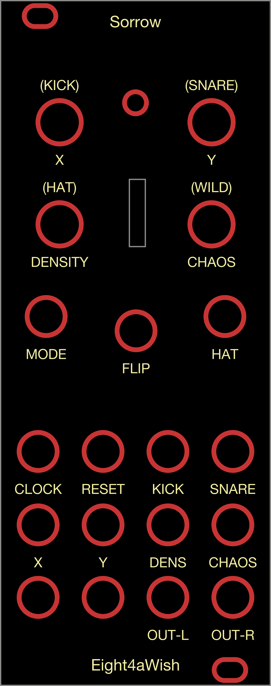
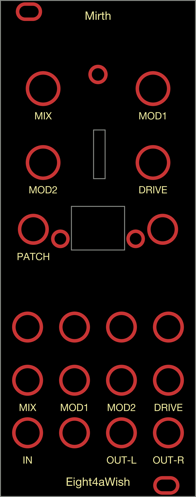
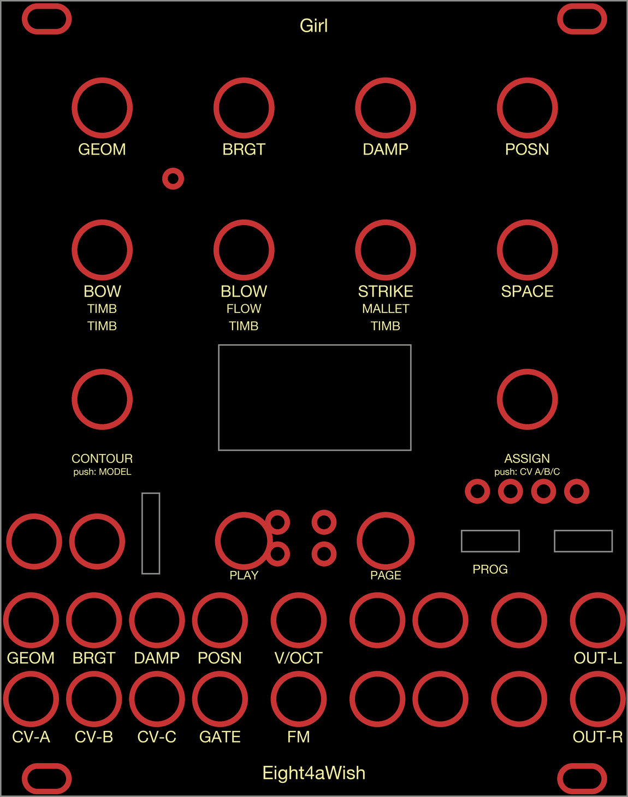
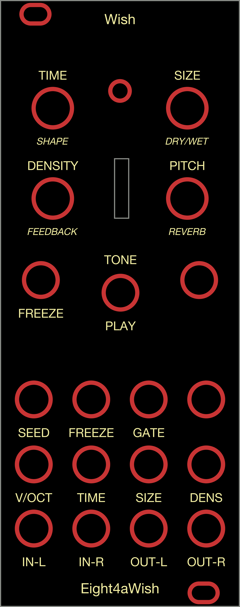
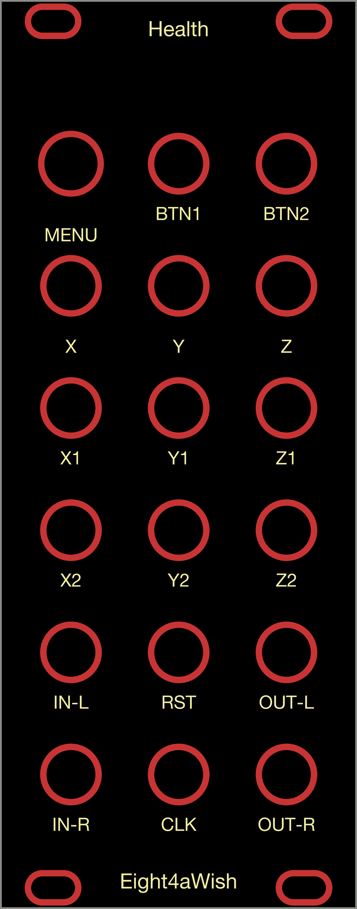

# PCB faceplates

The 3D-printed faceplates in [`../panels/`](../panels/) describe a set of holes,
cutouts and labels. That same description makes a perfectly good **PCB**
faceplate: black solder mask instead of black filament, white silkscreen instead
of white filament, and every hole plated, so the finish shows as a thin metal
ring through each one. This folder holds the KiCad projects and ready-to-upload
gerbers.

Generated by [`panels/kicad_faceplate.py`](../../panels/kicad_faceplate.py),
which reads the build123d panel script directly, so the PCB never drifts from
the printed panel.

| Folder | Module | Source script |
| --- | --- | --- |
| [`joy_10hp/`](joy_10hp/) | **Joy** — Braids macro-oscillator + 64×48 OLED, 10HP | [`panels/daisy_braids.py`](../../panels/daisy_braids.py) |
| [`sorrow_10hp/`](sorrow_10hp/) | **Sorrow** — Grids drum-pattern generator, 10HP | [`panels/daisy_grids.py`](../../panels/daisy_grids.py) |
| [`mirth_10hp/`](mirth_10hp/) | **Mirth** — NAM captures, not-amps and filters + 64×48 OLED, 10HP | [`panels/daisy_neural.py`](../../panels/daisy_neural.py) |
| [`girl_20hp/`](girl_20hp/) | **Girl** — Elements on a Ksoloti Big Genes, 20HP | [`panels/ksoloti_biggenes.py`](../../panels/ksoloti_biggenes.py) |
| [`wish_patch_init_10hp/`](wish_patch_init_10hp/) | **Wish on Daisy patch.Init()** — Beads on a stock patch.init, 10HP | [`panels/daisy_wish_patch_init.py`](../../panels/daisy_wish_patch_init.py) |
| [`p4_gesture_10hp/`](p4_gesture_10hp/) | **Health** — hand-tracking CV on the analogue board Rev B (ESP32-P4), N8Synth 10HP deck. Dropped for now (2026-11-04): gesture control is an app on Boy Rev B; this panel was already on order | [`panels/p4_gesture.py`](../../panels/p4_gesture.py) |

| Joy | Sorrow | Mirth | Girl | Wish on patch.Init() | Health |
| --- | --- | --- | --- | --- | --- |
|  |  |  |  |  |  |

## Regenerating

```sh
python3 panels/kicad_faceplate.py panels/daisy_braids.py \
    --outdir exports/pcb/joy_10hp --name joy_10hp \
    --title "Joy 10HP faceplate" --no-jlc-marker --gerbers

python3 panels/kicad_faceplate.py panels/daisy_grids.py \
    --outdir exports/pcb/sorrow_10hp --name sorrow_10hp \
    --title "Sorrow 10HP faceplate" --no-jlc-marker --gerbers

python3 panels/kicad_faceplate.py panels/daisy_neural.py \
    --outdir exports/pcb/mirth_10hp --name mirth_10hp \
    --title "Mirth 10HP faceplate" --no-jlc-marker --gerbers

python3 panels/kicad_faceplate.py panels/ksoloti_biggenes.py \
    --outdir exports/pcb/girl_20hp --name girl_20hp \
    --title "Girl 20HP faceplate" --no-jlc-marker --gerbers

python3 panels/kicad_faceplate.py panels/daisy_wish_patch_init.py \
    --outdir exports/pcb/wish_patch_init_10hp --name wish_patch_init_10hp \
    --title "Wish on patch.Init() 10HP faceplate" --no-jlc-marker --gerbers

python3 panels/kicad_faceplate.py panels/p4_gesture.py \
    --outdir exports/pcb/p4_gesture_10hp --name p4_gesture_10hp \
    --title "Health 10HP faceplate" --no-jlc-marker --gerbers
```

`kicad-cli` is not on `PATH` in a normal macOS install; it lives inside the app
bundle, so prefix the command with:

```sh
export PATH="/Applications/KiCad/KiCad.app/Contents/MacOS:$PATH"
```

### Two kinds of panel script

`joy_10hp`, `sorrow_10hp`, `mirth_10hp` and `wish_patch_init_10hp` come from Daisy Patch Init panels, which carry a
`HOLES` table in Electrosmith's own KiCad coordinates plus two parallel label
lists whose order has to be un-mirrored (see the module docstring).

`girl_20hp` and `p4_gesture_10hp` come from hand-authored panels that instead
carry a `LAYOUT` dict — one entry per control, each with its own position, diameter
and label. The generator reads the file with `ast` and never runs it, so a
`LAYOUT` must be written out in full: constants and indexing are fine, function
calls are not.
The generator reads both. Two things it has to convert for `LAYOUT`:

- **Y is measured upward** from the bottom edge (a jack is low, a pot is high),
  where KiCad measures downward. `y_kicad = panel_h - y_layout`.
- **Slot and window positions are centres**, not corners.

A `LAYOUT` control with neither a diameter nor a width/height is reported and
skipped rather than guessed at, because a guessed hole in a fab file is worse
than a missing one.

`--gerbers` shells out to `kicad-cli` (KiCad 7 or newer) to plot the fab set and
zip it. Without `kicad-cli`, open the `.kicad_pcb` and use **File → Fabrication
Outputs → Gerbers…** and **Drill Files…** (Excellon, millimetres, absolute
origin, separate PTH/NPTH files).

The board is written in the KiCad 6/7 file format, which KiCad 7, 8 and 9 all
open directly. Run the script with `--help` for the text-size, brand-margin and
plating options.

`preview.png` is the same board plotted flat — front copper, front silkscreen
and the outline, in KiCad's default theme colours (so the mask-free copper rings
come out red and the silkscreen pale yellow) on a black background:

```sh
kicad-cli pcb export svg --mode-single -o preview.svg \
    --layers F.Cu,F.SilkS,Edge.Cuts --page-size-mode 2 --exclude-drawing-sheet \
    exports/pcb/joy_10hp/joy_10hp.kicad_pcb
```

then rasterised over black at 575 px wide. **That is no longer how it works.**
`preview.png` is now drawn by the generator itself, from the same hole and label
tables the gerbers come from, so it cannot drift from what gets fabricated — and
it needs only PIL rather than a rasteriser. Pass `--no-preview` to skip it.

It is still a picture of the plot, not of the finished board: mask-free copper
rings red, silkscreen pale yellow, on black. The real panel is black mask with
white lettering and gold rings. **The preview's lettering is Helvetica Neue, not
the board's font.** The board gets KiCad's own stroke font, condensed to 72%
(David chose to keep it, 2026-11-03), as on the Joy and Sorrow boards. To see
the real lettering, render the board:

```sh
kicad-cli pcb render --side top --width 700 --height 1780 --background opaque \
    --quality high --output render.png exports/pcb/p4_gesture_10hp/p4_gesture_10hp.kicad_pcb
```

That render shows KiCad's default green mask; the colours are not the board's.

## What's in the design

Taken verbatim from the printed panel (which in turn comes from Electrosmith's
`blank.kicad_pcb` front-panel file, kept in
[`reference/Daisy_Patch_Init/`](../../reference/Daisy_Patch_Init/)):

- **50.8 × 128.5 mm** (10HP, 3U) outline on `Edge.Cuts`.
- **21 plated holes**, each with a 0.25 mm ring — 14 × Ø6.2 (jacks + button),
  4 × Ø7.2 (pots), 1 × Ø3.2 (LED), 2 × Ø3.0 (OLED mounting).
- **2 plated 5 × 3 mm mounting slots**, top-left and bottom-right.
- **microSD slot**, 3.208 × 12.802 mm internal cutout.
- **OLED window**, 14 × 11.5 mm internal cutout, where the Patch Init's B8
  toggle switch used to be — the toggle has to come off for the screen to fit.
- **White silkscreen labels** on the front, matching the printed panel's
  wording and positions.
- Nothing on the back: every board here is built with `--no-jlc-marker`, for
  the "Remove order number" route below.

### Differences from the 3D-printed panel

- The printed panel's base is mirrored about X (`export_transform` in the panel
  scripts) while its labels are not, so on the print the SD slot sits ~0.6 mm
  off its true position and the mounting slots land on the opposite diagonal.
  The PCB uses Electrosmith's true, unmirrored coordinates; only the
  label-to-hole assignment is un-mirrored to compensate. The finished panel
  reads identically.
- The button hole (B7) is Ø6.2 here because that is what `daisy_braids.py`
  specifies. Electrosmith's own panel drills it Ø5.5, which is a snugger fit on
  a TL1105 bushing. Change the `HOLES` entry if you want the tighter hole.
- Silkscreen uses KiCad's stroke font, condensed to 72% width so `OUT-L` /
  `OUT-R` stay inside the 12.17 mm jack pitch — KiCad's stock font is much wider
  per glyph than the Arial Bold the print uses.

## Ordering from JLCPCB

Upload the `-gerbers.zip` from the module's folder and set:

| Option | Value | Why |
| --- | --- | --- |
| Base material | FR-4 | |
| Layers | 2 | 1-layer boards have their own (worse) mask/silk options |
| Dimensions | detected from `Edge.Cuts` | 50.8 × 128.5 for the Daisy boards, 50.5 × 128.5 for Health, 101.3 × 128.5 for Girl |
| PCB thickness | **1.6 mm** | standard Eurorack panel thickness |
| PCB colour | **Black** (or your choice) | this *is* the panel colour |
| Silkscreen | **White** | the lettering |
| Surface finish | **ENIG** | gold, flat and lead-free through every plated hole; Hermetic's finish for their Alchemy Lab panels |
| Edge plating | No | Hermetic plate their edges too, but these boards don't mark edges for it |
| **Remove order number** | **Remove order number** | see below — and build the board with `--no-jlc-marker` |
| Gold fingers / castellated | No | |
| Panel / delivery format | Single PCB | not a panelised array |

Everything else can stay on its default.

### The order number, and the marker that goes with it

Left alone, JLCPCB put their order number wherever they like, which on a
faceplate means on the face. There are two ways out, and they need **different
gerbers**:

| Route | Build with | What ends up on the back |
| --- | --- | --- |
| **Remove order number** (JLCPCB's newer option, confirmed working) | `--no-jlc-marker` | nothing |
| Specify a location | default | the `JLCJLCJLCJLC` marker, which they replace with the number |

They are not interchangeable, because **the marker is drawn geometry, not an
instruction**: 4.7 KB of stroke lines in `-B_Silkscreen.gbo`. It does something
only if JLCPCB recognise the string and substitute for it. If "remove order
number" means merely "do not add one", the literal text `JLCJLCJLCJLC` prints on
the back of the board.

It is on the back, so it is invisible once the panel is on a module — but there
is no reason to carry it when the number is being removed, so every board here
is built without it. That drops the back silkscreen from 4.7 KB to a few
hundred bytes of header, i.e. nothing at all.

*Worth a look:* Joy's board (order `joy_10hp-gerbers_Y7`) was made from files
with the marker, ordered with "Remove Mark" and a remark asking for the number at
the marker. If the back of that board is blank, JLCPCB do strip it and this
distinction is academic. If it reads `JLCJLCJLCJLC`, it is not.

Internal cutouts are routed rather than drilled, so JLCPCB may add a small
"special process" line item. Their router leaves an inside-corner radius of about
0.5 mm, so cutout corners come out slightly rounded.

| Module | Cutouts | Note |
| --- | --- | --- |
| Joy, Mirth | 2 — SD slot, OLED window | window corners round off behind the display |
| **Sorrow, Wish** | **1 — SD slot only** | no OLED, so no window |
| Girl | 4 — OLED window, SD slot, 2 × USB | |
| Health | none | holes and rail slots only |

The only copper on the board is a 0.25 mm ring round each hole, with a matching
opening in the mask, and every hole is plated, so the finish runs through the
hole from the front ring to the back one. 0.25 mm is JLCPCB's recommended
annular ring for a 2-layer 1 oz board (`PLATED_RING` in the generator). The SD
slot and OLED window are routed cutouts with no ring. `--unplated` gives bare
holes instead: no copper at all, so the mask runs right up to the hole edge.

### What came back

The boards ordered in August came from earlier files: every hole in the
unplated (NPTH) drill file, with a 0.1 mm ring. What JLCPCB did with that ring
was their call. It is inside their
[guidance](https://jlcpcb.com/blog/npth-design-guide) that copper sit 0.2–0.3 mm
back from an unplated hole, and Joy and Sorrow came back differently from files
that were the same in this respect:

| Board | Order (gerbers) | Finish | What came back |
| --- | --- | --- | --- |
| Joy | `joy_10hp-gerbers_Y7` | HASL with lead | Holes plated, the finish running through them. David: it looks very good. |
| Sorrow | `sorrow_10hp-gerbers_Y8` | LeadFree HASL | No metal edging at the holes. |

Everything else on the two orders is the same: black mask, white ink-jet
silkscreen, 1.6 mm TG135, "Remove Mark", no production-file confirmation. Only
Joy's order-number remark differs. Joy's black also came out better than
Sorrow's; with two boards, the finish and batch variation cannot be told apart.

That is why the files now mark every hole plated: Joy's look on purpose,
whoever makes the board.

## Assembly notes

- Jack nuts tighten straight onto 1.6 mm FR-4; no washers needed beyond the ones
  supplied with the jacks.
- The OLED module mounts on the two Ø3.0 mm holes at (15.65, 61.75) and
  (35.15, 61.75), 19.5 mm apart, with M3 hardware or nylon standoffs.
- **Joy and Mirth:** the Patch Init's **B8 toggle switch must be removed** before
  the panel will seat, because the OLED window is where the toggle used to be —
  see the [Joy firmware
  README](https://github.com/Eight4aWish/eurorack_daisy_patch_init/tree/main/daisy_braids_oled).
- **Sorrow and Wish keep the B8 toggle.** It is Sorrow's FLIP and Wish's PLAY/TONE
  switch, so the panel has a Ø6.2 hole for it and nothing needs removing. Their
  panels are the same 50.8 × 128.5 outline as Joy's with 22 holes and a single
  SD cutout.
- **Health** is not a patch.init panel: it fronts the N8Synth 10HP control deck
  on the analogue board Rev B, with Boy's Rev A cell positions (the 2 mm lift that
  keeps the deck off the rack rail included) and hole sizes (6.9 mm, 7.5 mm for
  the encoder). The cell-by-cell wiring is in the panel script's docstring.

## Girl, and where its geometry came from

`girl_20hp` is a faceplate for the **Ksoloti Big Genes**, which is someone
else's board (Ksoloti, GPLv3). Until recently its panel CAD was not published,
so `panels/ksoloti_biggenes.py` was a photo reconstruction and the renders were
approximately right and precisely wrong — the jack rows were 1.2–1.7 mm out, the
middle band was 8 mm out, and every hole diameter came from a generic default
table rather than from the board.

It is now measured off `ksoloti_big_genes_panel-brd.svg`, a KiCad plot of the
real panel PCB **v0.8**. Checked both directions: 41 holes on the board, 41
controls in the `LAYOUT`, no mismatch in position or diameter, nothing on the
board left unplaced and nothing placed that is not on the board.

### Labels say what the module does, not what the board's pins are called

The first pass at `girl_20hp` reproduced the Big Genes' own pin names - P1 to P8
on the pots, CV-A to CV-D on the jacks. That documents the *board*. Girl is
Elements running on that board, so the panel now says GEOM / BRIGHT / DAMP / POS
and BOW / BLOW / STRIKE / SPACE, taken from
`eurorack_modules/docs/KSOLOTI_ELEMENTS.md`.

Both modules have controls whose function changes with a page, and a panel that
prints only the first state is documenting a fraction of the module:

| | pages | what changes |
| --- | --- | --- |
| **Girl** | 3, cycled by **S4** | P5-P7 are exciter *level*, then *meta* (Flow, Mallet), then *timbre*. P8 is Space in all three. |
| **Sorrow** | 2, cycled by a short press on **B7** | the four pots stop being X / Y / DENSITY / CHAOS and become the per-drum density trims plus **wildness**. |

Girl stacks its alternates under the primary name, smallest last. Sorrow puts its
one alternate above the pot in brackets, because the panel already has a label
below. Sorrow's omission was the worse of the two: the missing word was
**WILDNESS**, which is the control the module is named around.

Jacks carry both - the board's name in full size and Girl's use of it underneath
in lower case, since a Big Genes owner needs to find CV-A and a Girl player needs
to know it is Flow.

Two honest caveats:

- **The labels are still ours.** The real silkscreen is drawn as stroked
  outlines rather than as text, so it cannot be lifted mechanically. The jack
  wording below is our reading of what each one does.
- **The Ø1.7 hole at (27.92, 99.70)** is calibration access — a screwdriver hole
  for a trimmer on the board behind, labelled `CAL`. It is the one hole on the
  plot that is under 2 mm and still appears on every layer, which is what tells
  it apart from the silkscreen dots below.
- **The pot dial scales are silkscreen, not holes.** Eleven dots per pot, 30°
  apart on an r=8 circle, with the bottom 60° left out because that is the dead
  zone of a 300° pot: 88 in total. They appear on the plot's silkscreen layer
  *only*, and at Ø1.2 they are easy to filter out as sub-millimetre noise, which
  is exactly what happened the first time. A real hole shows on the mask and
  drill layers too — that is the test.

The mounting slots are the one deliberate departure: the plot gives 3 mm of
travel at 3.0 mm wide, and these are opened to 3.2 mm for M3 clearance, matching
the printed panels elsewhere in this repo.
